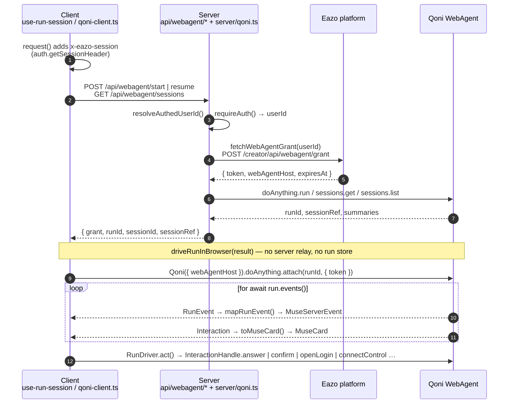
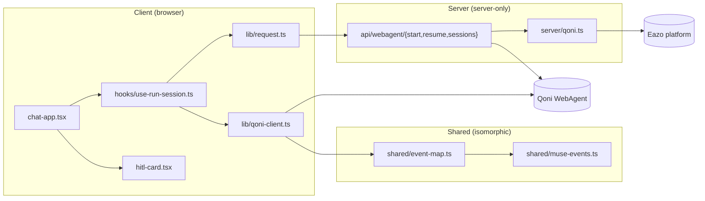

# AGENTS.md

Guidance for AI coding agents working in this repository. Read this before making changes.

## Project summary

A Next.js 15 (App Router) personal cloud-browser agent. Users sign in with Eazo, type a task, and a Qoni WebAgent `doAnything` run executes it in a cloud browser. The UI streams the agent's messages, shows the live browser screen in an iframe, and renders human-in-the-loop (HITL) cards for logins, confirmations, questions, forms, and take-control handoffs.

- Runtime: Bun for scripts, Node.js runtime for API routes.
- Dev server: `bun run dev` → `http://localhost:3200`.
- Package manager: `bun` (lockfile `bun.lock`).
- Path alias: `@/*` → `src/*`.

## Architecture

### Core invariant: token-to-browser, secrets-on-server

Component ownership at a glance:

Rules that follow from this:

1. `EAZO_PRIVATE_KEY`, `EAZO_APP_ID`, and anything from `src/server/**` must never reach the client. `src/server/*` files import `"server-only"`; keep it that way.
2. `userId` comes **only** from `resolveAuthedUserId(req)` (wraps `requireAuth` from `@eazo/sdk/server`). Never read a user id from a request body or query string.
3. The server does not relay events. There is no `/stream` SSE route and no in-process run store. Event consumption and HITL actions happen in the browser via `src/lib/qoni-client.ts`. Do not reintroduce a server relay unless the user asks.
4. `grant.token` is user-scoped and expiring; sending it to the browser is intentional. Do not log it, and do not log `liveUrl` values (they embed access credentials).
5. Session isolation is delegated to Qoni: `sessions.list({ token })` returns only the token owner's sessions. The app has no database and should not grow one for sessions.

### Event contract

`src/shared/muse-events.ts` defines the only event shapes the UI understands:

- `MuseServerEvent` union: `ready | message | progress | step | thinking | status | browsers | screen | card | done | error`.
  - `step` carries a `MuseStepUpdate` built from `run.action.started|completed|failed` (lifecycle, keyed by `action_id`) or `run.action.progress` (note, deduped by `seq`).
  - `thinking` is model reasoning (planning-type `run.message` the SDK folds into progress).
  - `status` comes from `run.status_changed`; `browsers` is the SDK's full `AgentBrowser[]` list (lead `main` + sub-agents).
  - `screen` carries `reload` (`forceViewerReload`) and `control` (a take-control / login surface URL).
  - `done.status` is `succeeded | failed | canceled | expired`, derived from `terminalReason`.
- `MuseCard`: a flattened projection of a Qoni `Interaction` (`id`, `type`, `status`, `title`, `prompt`, `expiresAt`, `actions[]`, type-specific `payload`). `status` is `pending | active | resolved | expired | canceled`; `isOpenCard()` = pending or active.
- `MuseCardAction`: `{ runId, interactionId, action, value? }` where `action` is one of `open_login | confirm_signed_in | answer | confirm | reject | submit | connect_control | refresh_control | release_control | skip`.
- `MuseBrowserControlAction`: `take | release | done | skip` on a sub-agent browser (`RunDriver.controlBrowser` → `doAnything.browsers.control`).
- `MuseSession`: `{ id, title, status, latestRunId, updatedAt }`.

`src/shared/event-map.ts` (`mapRunEvent`, `toMuseCard`) is the single place that translates Qoni wire types into these shapes. It is **not** server-only because it runs in the browser. Keep it a pure projection with no side effects and no token access. The SDK folds most internal wire types into `progress`; `mapRunEvent` re-classifies them by the raw wire type (`event.raw.data.type`) and drops telemetry noise (`DROPPED_WIRE_PREFIXES`: cost, recording, browser_agent, context, subtask, legacy input_request / take_control, …).

When adding a new Qoni event or interaction type: extend the union in `muse-events.ts`, add the mapping in `event-map.ts`, handle it in `handleServerEvent` in `hooks/use-run-session.ts`, and (for interactions) add a branch in `hitl-card.tsx` and `RunDriver.act()`.

### Routing / mounting model

- `src/app/layout.tsx` wraps everything in `I18nProvider` → `EazoProvider` and mounts `<ChatRoot />` once.
- `src/app/chat-root.tsx` parses `usePathname()` and passes `sessionId` (from `/c/:id`) to `<ChatApp />`.
- `src/app/page.tsx` and `src/app/c/[id]/page.tsx` return `null`. Navigation between `/` and `/c/:id` is a `router.push` that changes props only — the chat shell never remounts, so an active `run.events()` loop survives session switches that the user initiates from the same component.
- Do not render UI from page files; add UI to `ChatApp` or its children.

### Run lifecycle in `useRunSession`

`ChatApp` is a thin shell (layout + children). All run / session state and event handling live in `src/hooks/use-run-session.ts`.

- `start(prompt)` → `POST /api/webagent/start` → `startDriver(result)`; if the response has a new `sessionId`, set `shownSessionId` **before** `router.push`. The URL-sync effect reacts only to actual URL changes (`lastUrlIdRef`) and compares against `shownSessionIdRef`, so neither the intermediate render (state updated, URL still `/`) nor the final URL change resets the view or triggers a resume round-trip.
- `resumeSession(id)` → `POST /api/webagent/resume` → `startDriver(result)`; `{ empty: true }` means the session has no runs yet.
- `startDriver` always calls `driverRef.current?.stop()` first; only one driver is live at a time.
- Switching conversations (new chat / another session) is allowed while a run is active. It only detaches the browser-side driver; the run keeps executing on Qoni and can be re-attached by opening its session again. `viewGenRef` is bumped on every view change so late `/start` / `/resume` responses from the old view are ignored, and events from a replaced driver are dropped.
- `done` / `error` events set `running=false`, stop the driver, and refresh the session list.
- `card` events are upserted by `card.id` and filtered with `isOpenCard` (pending | active); settled cards disappear.
- `step` events upsert one thread row per `action_id` (a retry restarts the same row). `thinking` merges into the trailing thinking bubble with `mergeStreamingText` in `lib/chat-items.ts` (accepts both deltas and cumulative snapshots). `message` events replace text by `messageId` (the SDK's `text` is cumulative); a `human` message adopts the locally echoed prompt instead of duplicating it.
- `RunDriver` settles a stream that closed without `done`: it checks `run.status()`, synthesizes `done` if terminal, otherwise resumes from the last event id while the stream keeps making progress (bounded, like `RunHandle.wait()`). On `done` it reports every still-open interaction as `canceled`.
- While `running`, the composer's send button becomes a stop button → `RunDriver.cancel()` → `RunHandle.cancel()` (`POST /do_anything/runs/{id}/cancel`, needs the `webagent.do_anything:manage` scope on the grant). The stream then delivers `done` (canceled); if it doesn't within 5 s the driver synthesizes one. A stop pressed before `/start` returns is queued and applied once the driver exists. `RunDriver` emits at most one `done` per run.

### Browser pane

- On attach, `RunDriver` calls `doAnything.browsers.list` for the session and emits `browsers` with `snapshot: true`; `useRunSession` treats it as authoritative for the main viewer URL. Once it has arrived, replayed (pre-attach) browser / screen events are skipped, because their signed URLs may be stale. A follow-up `start()` in the same session keeps the current browser on screen (`resetRunView({ keepBrowser: true })`), since the session's browser outlives a run.
- The backend closes a lead browser nobody used for ~2 minutes (it emits `run.browser_live_url_changed` with an empty URL, which the SDK drops — `RunDriver` catches it via `onWireEvent` and emits `screen` with `liveUrl: ""`), and `browsers.list` is empty while the session's computer sleeps. So after a reload the list is usually empty. Like the Qoni Console's `EndedNotice`, `BrowserPane` then offers "Reopen", which calls `reopenSessionBrowser()` → `POST /do_anything/sessions/{sid}/browser/reconnect` (only legal between runs). While the pointer / focus is on the viewer, `touchSessionBrowser()` posts `/browser/activity` every 30s so it isn't closed. Both go through the SDK's internal `webAgentJson` transport because the SDK has no public wrapper for them.

`src/app/browser-pane.tsx` renders the live viewers:

- One tab per browser (`main` + sub-agents from the `browsers` event). A sub-agent with a `need` gets a badge and is auto-selected once; its need bar offers take / done / skip / hand back via `browser_control`.
- An iframe deck of up to 4 viewers: inactive ones are `opacity: 0`, not unmounted, so switching back is instant. The main viewer remounts only when `viewerKey` bumps (`forceViewerReload`, same URL re-sent, or a new control URL).
- Browserbase `postMessage("browserbase-disconnected")` (origin must be `https://*.browserbase.com`) shows a reconnect cover for that viewer.
- While the user holds the main browser (`take_control` card `active`, or a login / control URL from `open_login` / `connect_control`), the pane switches to interactive mode, auto-expands to a fixed full view, and offers "hand back" (`release_control`).

### HITL flow

`hitl-card.tsx` renders one `MuseCard` and emits `{ action, value }`. `useRunSession`'s `runCardAction` adds `runId` and `interactionId` and calls `driverRef.current.act()`. `RunDriver.act()` looks up the live `InteractionHandle` by `interactionId` and calls the matching SDK method. `open_login`, `connect_control` and `refresh_control` additionally emit a `screen` event (`control: true`) so the iframe switches to the login / control URL; the URL is cleared when the take_control / site_login card settles. Buttons are gated on `card.actions.includes(kind)` and on `expiresAt` not having passed — the server declares which actions are currently legal; do not hardcode availability.

### Buffer shim

`@qoniai/qoni` calls `Buffer.from(x, "base64url")` when decoding tokens. The browser `buffer` polyfill lacks `base64url`. `next.config.mjs` maps webpack's global `Buffer` (via `ProvidePlugin`) to `src/lib/buffer-shim.ts`, which patches it. `src/lib/qoni-client.ts` also imports the shim explicitly. If you touch `next.config.mjs`, keep this wiring intact; removing it produces `Unknown encoding: base64url` at runtime.

### Client-side `Qoni` instantiation

`clientFor(grant)` passes `fetch: window.fetch.bind(window)`. The SDK stores `fetch` as an instance property and calls it detached, which throws `Illegal invocation` without the bind. Preserve this.

### Internationalization (brief)

Client-only i18next with `en` / `zh` catalogs in `src/i18n/locales/`. All user-visible UI strings in components go through `t()`. API routes always return English errors via `apiMessage(key)` from `src/lib/i18n/api.ts` (reads `en.json` only). When adding a UI string, add it to **both** JSON files. Interpolation uses `{name}` (single braces), not i18next's default `{{name}}`.

## Core files

### Server

| File | Role |
| --- | --- |
| `src/server/qoni.ts` | `resolveAuthedUserId()` (wraps `requireAuth`) and `fetchWebAgentGrant(userId)` (calls the Eazo grant API). Server-only. |
| `src/server/run-errors.ts` | `errMsg()`, `isBusySessionError()` (detects 409 / conflict from Qoni). Server-only. |
| `src/app/api/webagent/start/route.ts` | `POST` — start a `doAnything` run (optionally in an existing session). Returns `{ grant, runId, sessionId, sessionRef }`; `409` if the session is busy. |
| `src/app/api/webagent/resume/route.ts` | `POST` — resolve `latestRunId` for a session and return the same shape as start, or `{ empty: true }`. |
| `src/app/api/webagent/sessions/route.ts` | `GET` — list the signed-in user's sessions (limit 30) as `MuseSession[]`. |
| `src/app/api/user/profile/route.ts` | `GET` — required by `@eazo/sdk`; exchanges `x-eazo-session` for `{ ok, user }`. |

### Shared (isomorphic)

| File | Role |
| --- | --- |
| `src/shared/muse-events.ts` | Event / card / session / action type contract between client and server. |
| `src/shared/event-map.ts` | `mapRunEvent(RunEvent) → MuseServerEvent \| null`, `toMuseCard(InteractionHandle) → MuseCard`. Pure projection. |

### Client

| File | Role |
| --- | --- |
| `src/lib/qoni-client.ts` | `driveRunInBrowser(result, onEvent) → RunDriver`. Attaches to a run, iterates events, settles streams that close without `done`, holds open `InteractionHandle`s, executes card actions and sub-agent browser control. |
| `src/lib/request.ts` | `fetch` wrapper that injects `x-eazo-session` and `x-locale`. Use it for all calls to `/api/*`. |
| `src/lib/buffer-shim.ts` | `base64url` patch for the browser `Buffer` polyfill. |
| `src/lib/chat-items.ts` | `ChatItem` type plus `mergeStreamingText` / `applyStepUpdate` for the thread. |
| `src/lib/chat-format.ts` | Pure helpers for session titles and relative timestamps. |
| `src/hooks/use-run-session.ts` | All run / session state: start / resume / stop, `handleServerEvent`, HITL / browser actions, session list, reopen. |
| `src/hooks/use-rail-layout.ts` | Sidebar width / collapse (`muse.railWidth`, `muse.railCollapsed`). |
| `src/hooks/use-pane-layout.ts` | Chat ↔ browser divider (`muse.browserWidth`). |
| `src/app/layout.tsx` | Root providers (`I18nProvider`, `EazoProvider`) and the single `<ChatRoot />` mount. |
| `src/app/chat-root.tsx` | Derives `sessionId` from the pathname and renders `<ChatApp />`. |
| `src/app/chat-app.tsx` | Thin shell: layout hooks + `useRunSession`, assembles rail / thread / composer / browser pane. |
| `src/app/session-rail.tsx` | Session list sidebar and new-chat control. |
| `src/app/chat-thread.tsx` | Message / step / thinking thread plus HITL card list. |
| `src/app/composer.tsx` | Prompt input; send / stop while a run is active. |
| `src/app/step-item.tsx` | Collapsible step row with notes / error. |
| `src/app/browser-pane.tsx` | Live browser pane: per-browser tabs, iframe deck, disconnect / reconnect, take-control mode, full view, sub-agent need bar. |
| `src/app/hitl-card.tsx` | Renders a `MuseCard` by type (`ask_user`, `confirmation`, `site_login`, `take_control`, `fill_form`, `wait`). |
| `src/app/user-menu.tsx` | Signed-in user menu in the session rail. |
| `src/app/markdown.tsx` | `react-markdown` + `remark-gfm` renderer for assistant replies; links open in a new tab. |
| `src/app/lang-switcher.tsx` | en/zh toggle calling `changeLocale()`. |
| `src/app/globals.css` | All styling (class-based, no CSS modules or Tailwind). |

### Config

| File | Role |
| --- | --- |
| `next.config.mjs` | Webpack `buffer` fallback + `ProvidePlugin` for the Buffer shim. `reactStrictMode: false`. |
| `.env.example` | Documents `EAZO_PLATFORM_API_BASE`, `EAZO_APP_ID`, `NEXT_PUBLIC_EAZO_APP_ID`, `EAZO_PRIVATE_KEY`, optional `QONI_WEBAGENT_HOST`. |
| `package.json` | Scripts: `dev`, `build`, `start`, `lint`, `sdk:sync` (copies a local `../eazo-sdk` build into `node_modules`). |

## Conventions

- `"use client"` on every component / lib that touches browser APIs or `@eazo/sdk` (non-server entry). API routes set `export const runtime = "nodejs"` and `export const dynamic = "force-dynamic"`.
- API routes return `NextResponse.json({ error })` with an appropriate status; the client throws `data?.error` into a `progress` bubble. Keep that shape.
- Local UI preferences use `localStorage` keys prefixed `muse.` (`muse.railWidth`, `muse.railCollapsed`, `muse.browserWidth`, `muse.locale.v1`).
- Code comments are English. API responses and error messages are English.
- No test suite exists. Verify changes with `bun run build` (type-checks) and `bun run lint`, then exercise the flow manually against a configured `.env.local`.

## Things not to do

- Do not add Qoni API keys or super keys to this repo or its env — the Eazo platform issues grants.
- Do not move event normalization or HITL execution to the server.
- Do not persist sessions, runs, or messages in app storage.
- Do not render content from page files; the shell is owned by `ChatRoot` / `ChatApp`.
- Do not commit `.env` / `.env.local`.
