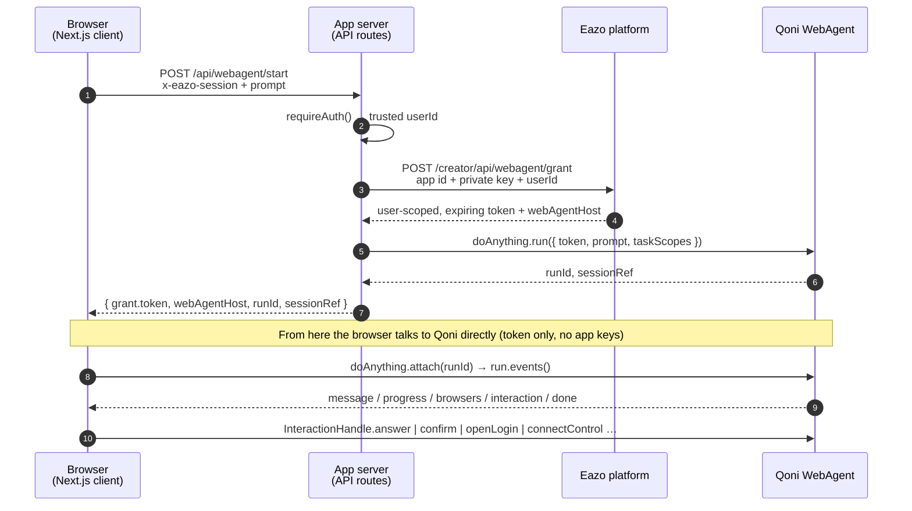

# eazo-creator-personal-agent-template

A personal cloud-browser agent built on the [Qoni WebAgent](https://docs.qoni.ai/webagent/getting-started/what-is-webagent) SDK and the Eazo platform. Describe a task in one sentence; the agent runs it in a cloud browser while you watch the live screen, answer its questions, and take over when needed.

## What it does

- **Natural-language web tasks** — one prompt starts a `doAnything` run in a cloud browser.
- **Live browser view** — the agent's screen is embedded in an iframe and updates as it navigates.
- **Human-in-the-loop (HITL)** — the agent pauses for site logins, confirmations, questions, form fills, or hands control to you, then continues.
- **Persistent sessions** — conversations are listed in a sidebar and can be resumed at `/c/:sessionId`; sessions are owned by Qoni, so the app keeps no database.
- **Eazo sign-in** — authentication is handled by `@eazo/sdk`; no Qoni keys are ever held by this app.

## Architecture

### Trust boundaries



Three principles drive the design:

1. **Secrets stay on the server.** `EAZO_PRIVATE_KEY` and `EAZO_APP_ID` are used only in API routes to verify the Eazo session and exchange it for a WebAgent grant. Qoni super keys live exclusively on the Eazo platform backend.
2. **Identity comes only from the verified session.** `user_id` is derived from `requireAuth(x-eazo-session)`, never from a request body.
3. **The browser drives the run directly.** After the server starts (or attaches to) a run, it hands the user-scoped token to the client. The client consumes `run.events()` and executes HITL actions directly against Qoni — no server-side SSE relay, no in-process run store.

### Request lifecycle

| Step | Where | What happens |
| --- | --- | --- |
| 1. Start | `POST /api/webagent/start` | Verify session → fetch grant → `doAnything.run({ prompt, taskScopes, session? })` → return `{ grant, runId, sessionId, sessionRef }`. A `409` is returned if the session's previous run is still busy. |
| 2. Attach | client `driveRunInBrowser()` | Builds a key-less `Qoni` client from the grant, calls `doAnything.attach(runId)`, and iterates `run.events()` with an `AbortController`. |
| 3. Normalize | `src/shared/event-map.ts` | Qoni `RunEvent`s are projected into a small `MuseServerEvent` union (`message`, `progress`, `screen`, `card`, `done`, `error`). The UI never touches Qoni wire formats. |
| 4. Interact | client `RunDriver.act()` | Pending `Interaction` events become `MuseCard`s; button clicks call the matching `InteractionHandle` method (`answer`, `confirm`, `openLogin`, `connectControl`, …). |
| 5. Resume | `POST /api/webagent/resume` | `sessions.get(sessionId)` → `latestRunId` → same attach flow, replaying history. |
| 6. List | `GET /api/webagent/sessions` | `sessions.list({ token })` — isolation is inherent because the token is user-scoped. |

### Routing model

`ChatApp` is mounted once in the root layout via `ChatRoot` and reads the session id from the URL (`/` for a new chat, `/c/:id` for an existing one). Page components render `null`, so switching sessions never remounts the chat shell or interrupts an active event stream.

## Run locally

```bash
bun install
cp .env.example .env.local   # fill in EAZO_* values
bun run dev                  # http://localhost:3200
```

### Environment variables

| Variable | Purpose |
| --- | --- |
| `EAZO_PLATFORM_API_BASE` | Eazo platform root (e.g. `https://eazo.ai`). Shared by `@eazo/sdk` and the grant exchange. |
| `EAZO_APP_ID` / `NEXT_PUBLIC_EAZO_APP_ID` | Host app id for `EazoProvider` and the grant request header. |
| `EAZO_PRIVATE_KEY` | Decrypts `x-eazo-session` in `requireAuth`; authenticates the grant request. Server-only. |
| `QONI_WEBAGENT_HOST` | Optional override; normally returned by the platform with the grant. |

## Scripts

| Script | Description |
| --- | --- |
| `bun run dev` | Dev server on port 3200 |
| `bun run build` / `bun run start` | Production build and serve |
| `bun run lint` | `next lint` |
| `bun run sdk:sync` | Copy a locally built `../eazo-sdk` into `node_modules/@eazo/sdk` for SDK development |

## Stack

Next.js 15 (App Router) · React 19 · TypeScript · `@eazo/sdk` · `@qoniai/qoni` · react-markdown · i18next (en/zh)
